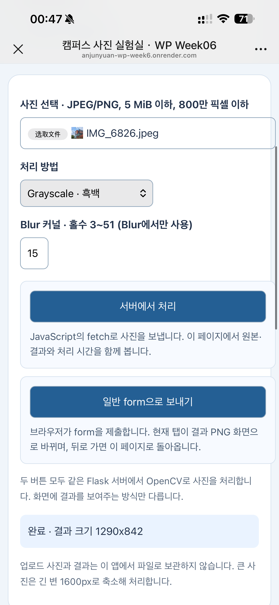
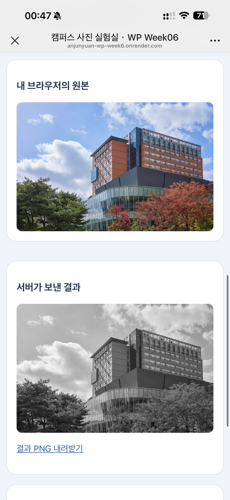
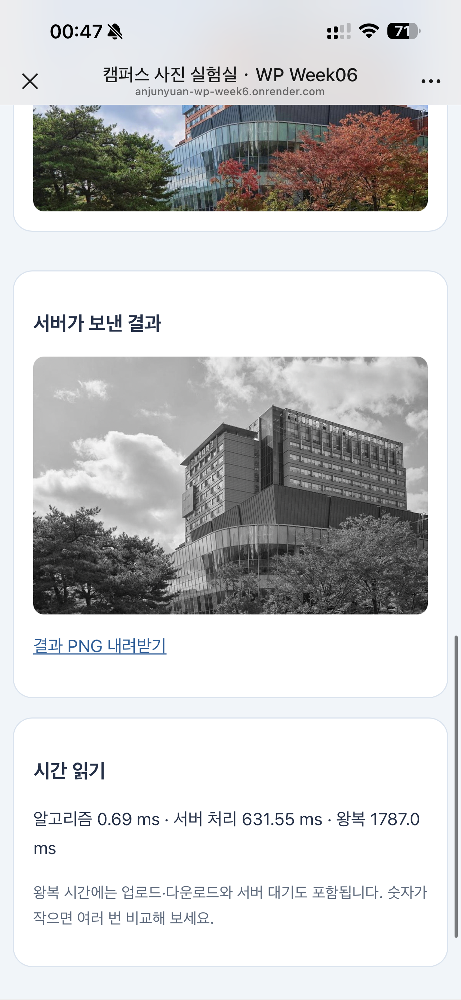
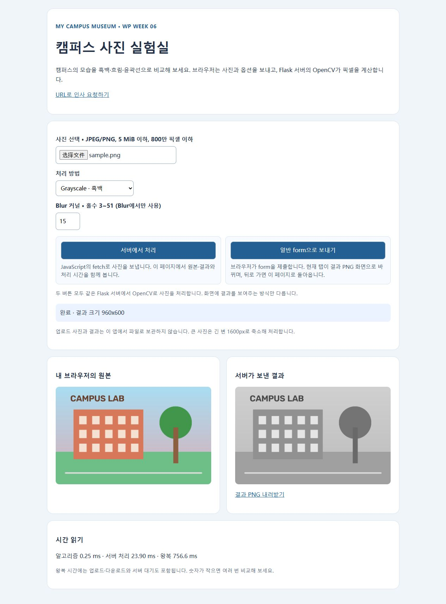
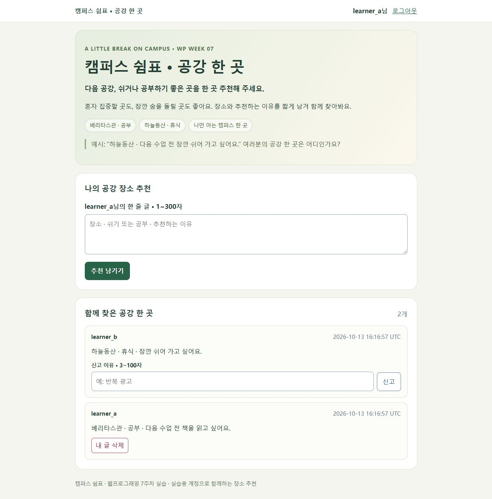
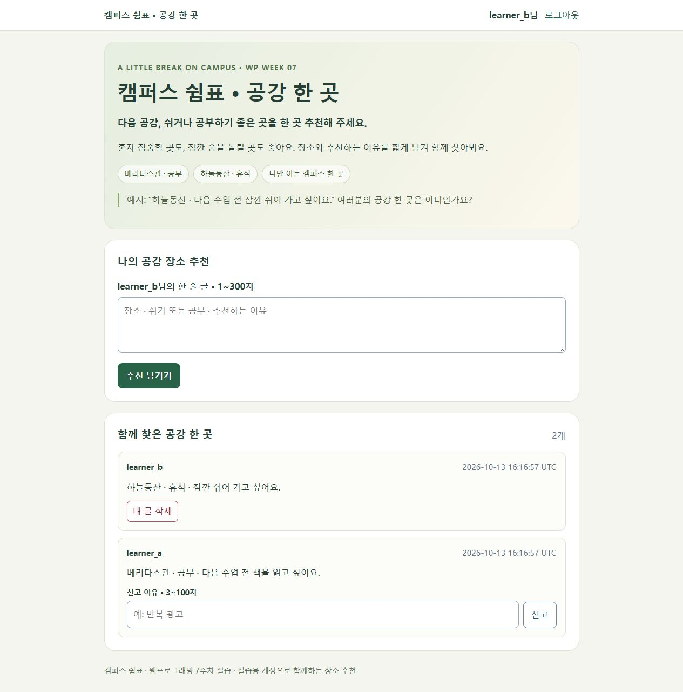
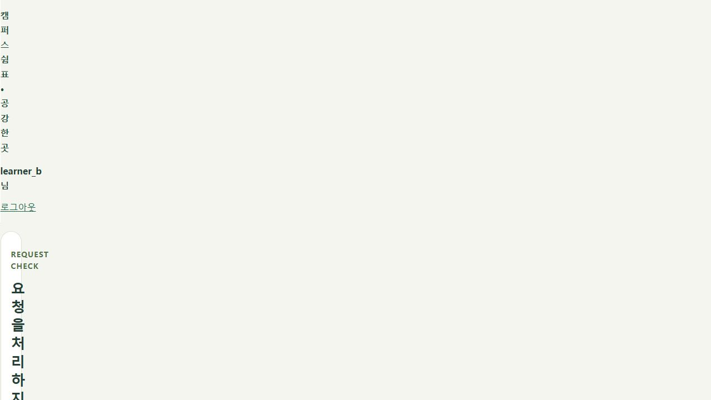
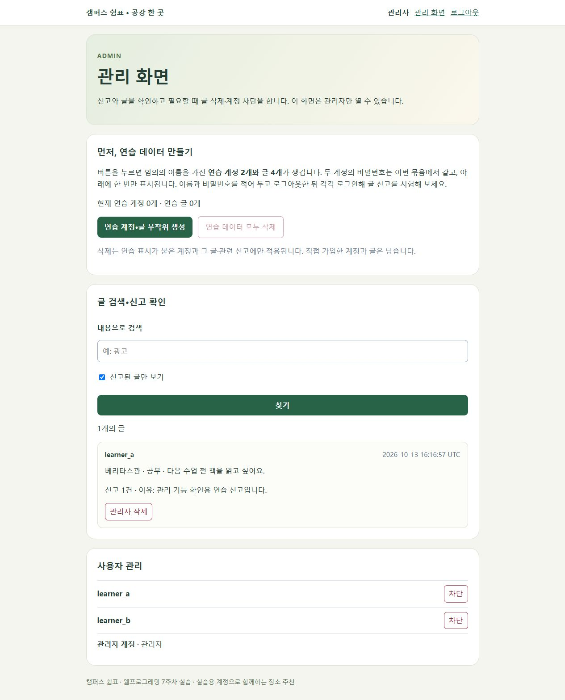

# 나만의 캠퍼스 박물관

가톨릭대학교 캠퍼스에서 직접 선택한 세 장소를 소개하는 웹 프로젝트입니다.

선정한 장소는 베리타스관(중앙도서관), 하늘동산, 예수성심성당입니다.

---

## Week 2 - HTML

Week 2에서는 HTML을 사용하여 캠퍼스 장소를 소개하는 웹사이트를 제작하였습니다.

### 선정 장소

1. 베리타스관 (중앙도서관)
2. 하늘동산
3. 예수성심성당

메인 페이지와 각 장소의 상세 페이지를 제작하였으며, 각 페이지에는 장소에 대한 설명, 사진, 추천 활동, 지도 링크 등을 추가하였습니다.

### 파일 구성

campus-museum2-main 폴더 안에 메인 페이지와 세 개의 장소 페이지, 이미지 폴더를 구성하였습니다.

### Week 2 웹사이트

https://a1141114a.github.io/anjunyuan/campus-museum2-main/

---

## Week 3 - CSS & Responsive Design

Week 3에서는 Week 2에서 만든 웹사이트에 CSS를 적용하여 디자인을 개선하였습니다.

하나의 외부 CSS 파일인 styles.css를 사용하였으며, 네 개의 HTML 페이지에서 같은 CSS 파일을 연결하여 사용하였습니다.

### 페이지별 디자인

각 페이지에 서로 다른 class를 지정하여 페이지마다 다른 분위기를 표현하였습니다.

- 메인 페이지: 밝고 깔끔한 카드 스타일
- 베리타스관(중앙도서관): 차분하고 책을 연상시키는 분위기
- 하늘동산: 자연을 표현한 초록색 중심의 디자인
- 예수성심성당: 어두운 색상과 금색을 활용한 차분한 디자인

### 반응형 디자인

모바일 화면을 위해 max-width: 600px 기준의 media query를 사용하였습니다.

모바일에서는 제목, 글자, 여백, 이미지 등이 화면 크기에 맞게 표시되도록 조정하였습니다.

스마트폰에서 메인 페이지와 세 개의 장소 페이지를 직접 확인하였으며, 이미지와 링크가 정상적으로 작동하는 것을 확인하였습니다.

### Week 3 웹사이트

https://a1141114a.github.io/anjunyuan/campus-museum2-main/

---

## Week 4 - JavaScript & Data Visualization

Week 4에서는 JavaScript와 DOM, CSV 데이터 시각화, HTML Canvas를 활용하여 세 가지 기능을 구현하였습니다.

### 1. Interactive Campus Hotspots

JavaScript와 DOM을 사용하여 세 개의 캠퍼스 장소를 하나의 페이지에서 선택하여 볼 수 있도록 구현하였습니다.

사용자가 버튼을 클릭하면 선택한 장소의 내용만 화면에 표시됩니다.

장소:
- 베리타스관 (중앙도서관)
- 하늘동산
- 예수성심성당

각 장소에는 사진, 장소 설명, 추천 활동과 Google Maps 지도를 추가하였습니다.

페이지:

https://a1141114a.github.io/anjunyuan/week4/

---

### 2. Data Visualization

World Bank의 Population, total 데이터를 CSV 형식으로 불러와 Chart.js를 이용하여 시각화하였습니다.

Papa Parse를 이용하여 population.csv 파일을 읽고 두 개의 서로 다른 그래프를 제작하였습니다.

### 분석 내용

1. 2000년 이후 한국, 중국, 일본의 인구는 어떻게 변화했을까?
2. 2024년 한국, 중국, 일본의 인구 규모는 어떻게 다를까?

첫 번째 그래프는 선 그래프를 이용하여 연도별 인구 변화를 보여주고, 두 번째 그래프는 막대그래프를 이용하여 2024년 세 국가의 인구를 비교합니다.

중국의 인구는 한국과 일본에 비해 매우 많은 것을 확인할 수 있다. 한국의 인구 변화는 비교적 크지 않은 반면, 일본은 인구가 감소하는 추세를 보이고 있다.

또한 한국과 일본은 인구 고령화가 점점 심화되고 있다. 따라서 총인구 데이터만으로는 사회 전체의 연령 구조를 정확하게 파악하기 어렵다는 한계가 있다.

### 데이터 정보

- 데이터: Population, total
- 분석 기간: 2000년 이후
- 비교 대상: 대한민국, 중국, 일본
- 단위: 명 (people)
- 출처: World Bank

데이터 출처:

https://data.worldbank.org/indicator/SP.POP.TOTL

페이지:

https://a1141114a.github.io/anjunyuan/week4/statistics.html

---

### 3. Canvas Mini Game - 공 피하기

HTML Canvas와 JavaScript를 이용하여 떨어지는 공을 피하는 미니게임을 제작하였습니다.

### 게임 방법

- 키보드의 왼쪽/오른쪽 방향키로 플레이어를 움직입니다.
- 모바일에서는 화면의 왼쪽/오른쪽 버튼을 사용합니다.
- 위에서 떨어지는 공과 충돌하면 게임이 종료됩니다.
- 살아남는 동안 점수가 증가합니다.
- 다시 시작 버튼을 누르면 게임을 다시 시작할 수 있습니다.

### Playtest & Improvement

처음 게임을 테스트했을 때 게임이 진행되어도 난이도가 크게 변하지 않는 점을 확인하였습니다.

이를 개선하기 위해 점수가 높아질수록 새로 생성되는 공의 속도가 빨라지도록 수정하였습니다. 따라서 플레이 시간이 길어질수록 게임의 난이도가 점차 증가합니다.

또한 PC에서는 키보드 방향키를 사용할 수 있고, 모바일에서는 터치 버튼을 사용할 수 있도록 구현하였습니다.

페이지:

https://a1141114a.github.io/anjunyuan/week4/game.html

---

## GitHub Pages

Week 2 / Week 3:

https://a1141114a.github.io/anjunyuan/campus-museum2-main/

Week 4 - Interactive Campus Hotspots:

https://a1141114a.github.io/anjunyuan/week4/

Week 4 - Data Visualization:

https://a1141114a.github.io/anjunyuan/week4/statistics.html

Week 4 - Canvas Mini Game:

https://a1141114a.github.io/anjunyuan/week4/game.html


---

# 웹프로그래밍 Week 06 · 캠퍼스 서버 실험

교수님이 제공한 `week06-server-lab.zip`을 바탕으로 제작했습니다. 기존 캠퍼스 박물관의 장소를 영어로 안내하는 기능과 캠퍼스 사진 실험실을 추가했습니다.

## 진행 상태

- 로컬 이미지 처리와 영어 TTS 실행 및 브라우저 확인 완료.
- Render 이미지 서비스 배포 완료: https://anjunyuan-wp-week6.onrender.com/
- 외부 접속에서 `/health`의 `{"status":"ok"}`, 이미지 API의 `200 image/png`와 실제 결과 PNG를 확인했습니다. 휴대전화에서도 JPEG 업로드와 흑백 결과 표시를 확인했습니다.

Render는 GitHub `main` 브랜치의 `week6` 폴더를 사용하며 Python 3.12.12, Free 인스턴스, Gunicorn으로 실행합니다. 서버의 시작 코드는 `app:app`이며 TTS는 안내대로 로컬에서 실행합니다. 처음 배포한 소스는 `4bd9427`입니다. 배포 후 사진 선택 안내 문구를 수정한 커밋 `7cf3f79`를 푸시했습니다. 공개 URL을 새로고침하여 새 문구 `JPEG/PNG 사진을 선택한 뒤 처리 방법을 골라 보세요.`가 표시되는 것을 확인했습니다. 자동 재배포가 반영되었습니다.

외부 HTTP 요청으로 교수님 샘플(960×600)을 Blur 31로 처리한 결과: 계산 **9.57 ms**, 서버 처리 **529.98 ms**, 결과 크기 **960×600**, 응답 크기 **178731 bytes**, `Cache-Control: no-store`. 로컬 표의 값과 서버 환경이 다르며, 이 외부 요청에서는 브라우저 왕복 시간을 측정하지 않았습니다.

외부 브라우저에서도 샘플을 Grayscale로 전송하여 계산 0.25 ms, 서버 처리 23.90 ms, 왕복 756.6 ms와 원본/흑백 결과 표시를 확인했습니다.

### 휴대전화 검증

휴대전화에서 Render 공개 URL에 접속하여 `IMG_6826.jpeg`를 업로드하고 Grayscale로 처리했습니다. 원본의 색이 제거된 결과와 PNG 다운로드 링크가 정상적으로 표시되었습니다. 실제 처리 크기는 **1290×842**, 계산 시간은 **0.69 ms**, 서버 처리 시간은 **631.55 ms**, 왕복 시간은 **1787.0 ms**였습니다. 별도의 Render 서버가 처리하므로 로컬 Flask 서버 주소를 사용하지 않습니다. 아래는 사용자가 직접 제공한 휴대전화 실행 화면입니다.






## 직접 추가한 기능

- 베리타스관/중앙도서관, 하늘동산, 예수성심성당의 영어 안내 문장 선택 버튼 3개.
- 선택한 문장을 수정하고 읽기 속도를 조절한 뒤 서버에서 새 WAV를 생성할 수 있습니다.
- 선택 장소 표시와 요청 중 전체 입력 비활성화로 중복 요청을 방지합니다.
- `/hello`의 기본 이름을 `새 친구`로 바꾸고 캠퍼스 박물관 환영 문구를 추가했습니다. 이름은 Jinja의 기본 HTML 이스케이프를 유지합니다.

## Task 1 · 이미지 처리

`POST /api/process`에 `multipart/form-data`로 `image`, `operation`, `kernel`을 보냅니다. 성공 응답은 `200 image/png`이며, 응답 헤더 `X-Compute-Ms`, `X-Processing-Ms`, `X-Image-Size`를 읽습니다. 일반 form은 결과 PNG로 이동하고 fetch는 현재 페이지의 원본·결과·시간을 갱신합니다.

교수님 샘플 PNG를 사용한 로컬 브라우저 실측입니다. 큰 입력은 같은 샘플을 2400×1500으로 확대한 것이며 새로운 세부 정보가 생긴 것은 아닙니다. 왕복 시간은 브라우저의 `performance.now()`로, 나머지는 서버 응답 헤더로 기록했습니다.

| 입력 크기 | 처리 | 커널 | 실제 처리 크기 | 계산 ms | 서버 ms | 왕복 ms |
|---|---|---:|---|---:|---:|---:|
|960×600|Grayscale|15 (미사용)|960×600|0.25|16.15|24.1|
|960×600|Blur|3|960×600|0.76|6.12|10.0|
|960×600|Blur|31|960×600|4.90|11.59|19.0|
|960×600|Edge|31 (미사용)|960×600|1.07|4.28|8.0|
|2400×1500|Blur|31|1600×1000|11.63|40.91|49.3|

Blur 커널이 커질수록 계산량이 증가했습니다. 큰 사진은 긴 변 1600px로 축소한 뒤 처리하므로 원본 크기와 실제 처리 크기를 구분했습니다. 서버 처리 시간에는 디코딩·인코딩 등이 포함되고 왕복에는 전송과 대기도 포함됩니다. 위 수치는 단일 요청 결과로 기기 전체 성능을 대표하지 않습니다.


Flask 테스트 클라이언트에서 파일 누락/잘못된 옵션 `400`, 5 MiB 초과 `413`, 없는 경로 `404`, 정상 PNG 디코딩 및 크기 제한을 확인했습니다. 업로드와 결과는 메모리에서 처리하며 서버 파일로 저장하지 않습니다.

## Task 2 · 캠퍼스 영어 안내

용도는 캠퍼스 방문자에게 세 장소를 짧은 영어 문장으로 소개하는 것입니다. `POST /api/tts`에 JSON `{ "text": "...", "length_scale": 1.0 }`을 전송합니다. Flask의 Piper가 실제 음성을 만들고 `200 audio/wav`를 반환합니다. 브라우저가 WAV를 디코딩해 파형과 음성 길이, 크기를 표시합니다. 브라우저 자체 음성 합성이나 미리 녹음한 파일을 사용하지 않습니다.

모델은 영어용 `en_US-lessac-low`입니다. 모델과 설정 파일은 직접 내려받으며 Git에 포함하지 않습니다. 처음 요청은 모델 로딩을 포함하므로 이후 요청과 시간이 다릅니다.

| 브라우저에서 확인한 문장 | 서버 생성 ms | 음성 길이 s | WAV KiB |
|---|---:|---:|---:|
|Welcome to Veritas Hall and the central library. Take a quiet moment to read and explore.|2270.4|5.38|168.0|
|Welcome to Sky Garden. Enjoy a peaceful break and the greenery around you.|83.1|4.37|136.5|

각 문장의 음절과 쉬는 구간에 따라 파형과 길이가 달라졌습니다. 요청 중 Processing 표시와 버튼 비활성화, 생성 후 버튼 복구 및 다운로드 링크를 브라우저에서 확인했습니다. 빈 문장·300자 초과·지원하지 않는 언어 `400`, 모델 누락 `503`과 안내 메시지, 실제 WAV 헤더 및 길이는 테스트 클라이언트로 확인했습니다.


## AI 활용

AI는 일부 코드 작성·수정과 보고서 문장 다듬기에 활용했다.

---

## 실행 안내

먼저 저장소의 `week6` 폴더로 이동합니다: `cd week6`.


Python 3.12 환경을 사용합니다. 전체 수업 설명은 강의 사이트의 6주차 자료에 있습니다.

## 이미지 실험실

```sh
python -m pip install -r requirements.txt
python -m flask --app app run --debug --port 5000
```

브라우저에서 http://127.0.0.1:5000 을 엽니다. VS Code Live Server로 HTML을 열지 않습니다.
샘플 이미지는 `static/sample.png`입니다. 사진은 JPEG/PNG, 5 MiB 및 800만 픽셀 이하입니다.

## 서버 TTS

이미지 서버를 Ctrl+C로 종료한 뒤 실행합니다.

```sh
python -m pip install -r requirements-tts.txt
python -m piper.download_voices en_US-lessac-low --download-dir models
python -m flask --app tts_app run --debug --port 5000
```

http://127.0.0.1:5000/tts 를 엽니다. 기본 모델은 영어용입니다.
영어 문장을 보내면 서버가 WAV를 만들고 브라우저가 파형, 서버 생성 시간, 음성 길이와 파일 크기를 표시합니다.
실습실에 스피커가 없어도 파형으로 결과를 확인할 수 있습니다. 재생과 다운로드는 선택 기능입니다.
이 TTS 실습은 Windows PC의 로컬 서버에서 실행하며 별도 배포하지 않습니다.
모델은 직접 내려받으며 이 배포 파일에는 포함하지 않습니다.
엔진과 음성 모델의 이용 조건은 각 프로젝트에서 확인합니다.

- Piper: https://github.com/OHF-Voice/piper1-gpl
- 모델 카드: https://huggingface.co/rhasspy/piper-voices/blob/main/en/en_US/lessac/low/MODEL_CARD

## Render 이미지 앱 설정

학생 저장소의 `week6` 폴더에 이 파일들을 둡니다.
Root Directory: `week6`
Build Command: `pip install -r requirements.txt`
Start Command: `gunicorn app:app --bind 0.0.0.0:$PORT --workers 1 --threads 2 --timeout 120`
Python은 3.12 계열을 지정합니다. 수업 자료의 배포 절차를 확인하세요.

이 앱은 업로드 이미지와 생성한 결과를 영구 저장하지 않습니다.
프론트엔드는 같은 Flask 서버가 제공하므로 별도 CORS 설정은 사용하지 않습니다.


---

# 웹프로그래밍 Week 07 · 캠퍼스 쉼표

## 주제와 제작 내용

**공강에 쉬거나 공부하기 좋은 장소를 추천하는 한 줄 게시판**입니다. 제목은 `캠퍼스 쉼표 · 공강 한 곳`, 질문은 `다음 공강, 쉬거나 공부하기 좋은 곳을 한 곳 추천해 주세요.`로 정했습니다. 장소·휴식 또는 공부·추천 이유를 짧게 남기는 방식입니다. 베리타스관과 하늘동산을 예시로 제시하고 초록색과 크림색으로 화면을 구성했습니다.

교수님이 제공한 `week07-starter.zip` → `week07-feed.zip` → `week07-flask-comments.zip` 순서로 실행·확인했습니다. 최종 소스는 관리 기능 단계의 전체 코드를 바탕으로 하며, 각 단계에서 **같은 DB를 유지**해 계정과 글이 보존되는지 확인했습니다.

로컬 구현·검증과 화면 기록은 완료했습니다. **Render 배포 및 서로 다른 실제 브라우저에서의 최종 접속 확인은 진행 예정**입니다.

## 수정한 파일

| 파일 | 수정 내용 |
|---|---|
|`app.py`|게시판 제목과 질문을 공강 장소 추천 주제로 변경|
|`templates/comments.html`|초대 문구·장소 예시·입력 힌트·추천 버튼·목록 제목 변경|
|`templates/base.html`|주제에 맞는 하단 문구, 관리자 이름 대신 역할 표시|
|`templates/admin.html`|관리자 계정명을 화면 기록에 노출하지 않도록 역할로 표시|
|`static/style.css`|초록색·크림색 테마와 장소 태그|

비밀번호 해시, 매개변수 SQL, 서버 측 작성자·관리자 권한 확인, CSRF, 차단, 속도 제한과 DB 구조는 교수님 코드의 동작을 유지했습니다.

## 저장 방식 비교

`mini_storage.py`를 새 폴더에서 두 번 실행한 결과입니다.

| 실행 | Python 리스트 | JSON 파일 | SQLite 파일 |
|---|---:|---:|---:|
|첫 번째|1|1|1|
|두 번째|1|2|2|

리스트는 새 프로세스에서 초기화되지만 JSON과 SQLite는 이전 파일을 읽어 누적했습니다. 게시판은 사용자와 글의 관계를 조회해야 하므로 SQLite를 사용합니다. 이 실험의 파일과 게시판의 `app.db`는 서로 다릅니다.

## 로컬 실행 · Python 3.12

저장소의 `week7` 폴더에서 PowerShell로 실행합니다. 이미 사용하는 Python 3.12 환경이 있으면 가상환경 생성·활성화 단계는 생략합니다.

```powershell
python -m venv .venv
.\.venv\Scripts\Activate.ps1
python -m pip install -r requirements.txt
$env:SECRET_KEY = (& python -c "import secrets; print(secrets.token_hex(32))")
python -m flask --app app init-db
python -m flask --app app run --debug --port 5000
```

`http://127.0.0.1:5000/`을 엽니다. 실행 화면 기록에서는 이전 주차 서버와 충돌하지 않도록 **5001 포트**를 사용했습니다. debug는 로컬에서만 사용합니다. 서버를 다시 켤 때 같은 `SECRET_KEY`와 DB 경로를 사용합니다. `init-db`는 기존 데이터를 지우지 않습니다.

관리자용 실습 계정을 웹에서 먼저 가입한 뒤 서버를 멈추고, 같은 터미널에서 가입한 ID를 지정합니다. 실제 관리자 ID·PW는 공개 문서에 적지 않습니다.

```powershell
$env:WEEK7_ADMIN_USERNAME = Read-Host "가입한 실습용 관리자 ID"
python -m flask --app app promote-admin
python -m flask --app app run --debug --port 5000
```

## 두 계정·권한 확인

서로 독립된 Flask 테스트 클라이언트와 쿠키로 아래 요청을 검증했습니다. 실제 브라우저에서는 A로 로그인한 화면과 로그아웃 후 B로 바꾼 화면을 각각 기록했습니다. 두 캡처가 동시에 열린 서로 다른 브라우저라는 뜻은 아닙니다.

| 확인 | 실제 결과 |
|---|---|
|중복 아이디 / 잘못된 비밀번호|400 / 401로 거부|
|로그인 후 다음 요청 / 독립 클라이언트|로그인 유지 / 다른 클라이언트는 비로그인|
|시작 → 피드 → 관리 단계|새 프로세스에서도 기존 계정 3개와 추천 글 2개 유지|
|A 글을 B가 조회|같은 글이 보이며 A 글의 삭제 버튼 없음|
|B가 A 글 삭제 주소에 직접 POST|403으로 거부, 글 유지|
|본인 글 삭제|성공 후 목록으로 이동|
|`<script>alert(1)</script>` 글|이스케이프된 문자로 표시|
|CSRF 값 없이 POST|400으로 거부|
|빈 글 / 300자 초과|400으로 거부|
|일반 계정의 `/admin` 및 관리 POST|403으로 거부|
|1분 동안 글 3개 이후 추가 작성|429로 거부|
|세션 쿠키|HttpOnly와 SameSite=Lax 확인|





## 관리 기능 확인

- `promote-admin`으로 로컬 관리자 역할을 지정했습니다. `ensure-admin` 반복 실행은 성공하고, 같은 이름의 일반 계정을 관리자로 바꾸려는 경우에는 거부됐습니다.
- 연습 데이터 생성 시 임의 계정 **2개**, 글 **4개**가 생성됐습니다. B가 A의 글을 신고한 뒤 신고 전용 필터와 검색으로 이유를 확인했습니다.
- 중복 신고와 자기 글 신고는 400으로 거부됐습니다. 관리자 삭제 후 해당 글의 신고도 외래 키 규칙에 따라 사라졌습니다.
- 차단한 계정은 새 로그인에서 403을 받았고 기존 세션으로도 글을 쓸 수 없었습니다. 차단 해제 후 다시 로그인할 수 있었습니다.
- 연습 데이터 정리 후 연습 계정과 글이 0개가 됐으며 원래 계정과 추천 글은 유지됐습니다.

아래는 임시 비밀번호 표시가 없는 상태에서 기록했습니다. 표시된 신고는 관리 기능 확인용 연습 신고입니다.



## Render 배포 설정

6주차 서비스는 유지하고 **새 Web Service**를 생성합니다.

| 항목 | 값 |
|---|---|
|저장소 / 분기|`a1141114a/anjunyuan` / `main`|
|Language|Python 3|
|Root Directory|`week7`|
|Build Command|`pip install -r requirements.txt`|
|Instance Type|Free · 생성 전 실제 요금 표시 확인|
|Health Check Path|`/` · 이 앱에는 `/health` 경로가 없음|

Start Command:

```sh
python -m flask --app app init-db && python -m flask --app app ensure-admin && gunicorn app:app --bind 0.0.0.0:$PORT --workers 1 --threads 2
```

Environment:

| 이름 | 설정 |
|---|---|
|`SECRET_KEY`|비공개 무작위 64자리 값|
|`WEEK7_ADMIN_USERNAME`|실습 전용 관리자 ID · 영문/숫자/밑줄 3~20자|
|`WEEK7_ADMIN_PASSWORD`|실습 전용 무작위 비밀번호 · 12~128자|
|`APP_HTTPS`|`1`|
|`PYTHON_VERSION`|`3.12.12`|

무료 Render의 SQLite 파일은 재시작·재배포 시 사라질 수 있습니다. 시작 명령은 DB와 관리자 계정을 다시 준비하므로 기능 시연은 가능하지만 장기 보관용은 아닙니다. `instance/`, `.env`, 비밀 키와 비밀번호는 Git에 포함하지 않습니다.

## 제출 항목

사이버캠퍼스에 **GitHub 저장소 URL, Render 서비스 URL, 관리자 ID, 관리자 PW**를 적습니다. ID·PW는 그 제출란에서만 공유하며 README나 공개 화면에는 적지 않습니다. `SECRET_KEY`와 DB 파일은 제출하지 않습니다. 배포 후 다른 실제 브라우저에서 관리자 로그인과 관리 기능을 다시 확인합니다.

## AI 활용

AI는 일부 코드 작성·수정과 보고서 문장 다듬기에 활용했다.

## 교수님 자료

- [웹프로그래밍 7주차](https://cg.catholic.ac.kr/~mgchoi/WP/weeks/week07/)
- [시작 코드 ZIP](https://cg.catholic.ac.kr/~mgchoi/WP/downloads/week07-starter.zip)
- [첫 실습 ZIP](https://cg.catholic.ac.kr/~mgchoi/WP/downloads/week07-feed.zip)
- [관리 기능 ZIP](https://cg.catholic.ac.kr/~mgchoi/WP/downloads/week07-flask-comments.zip)
