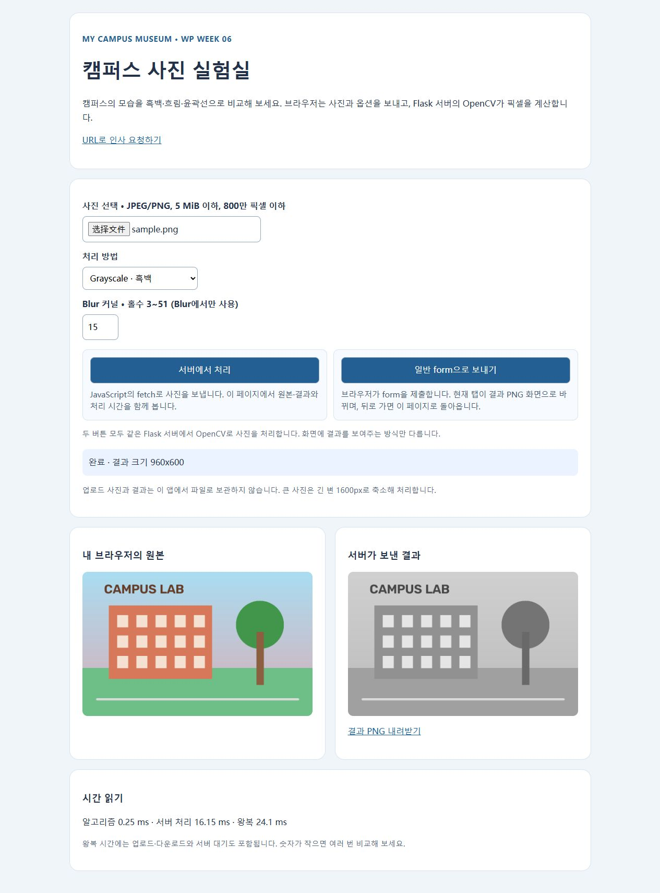
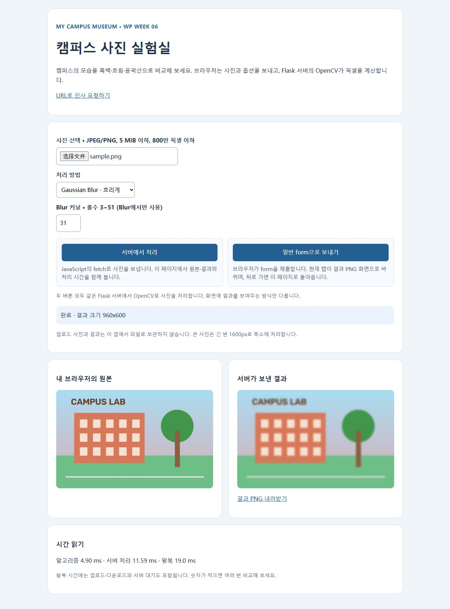
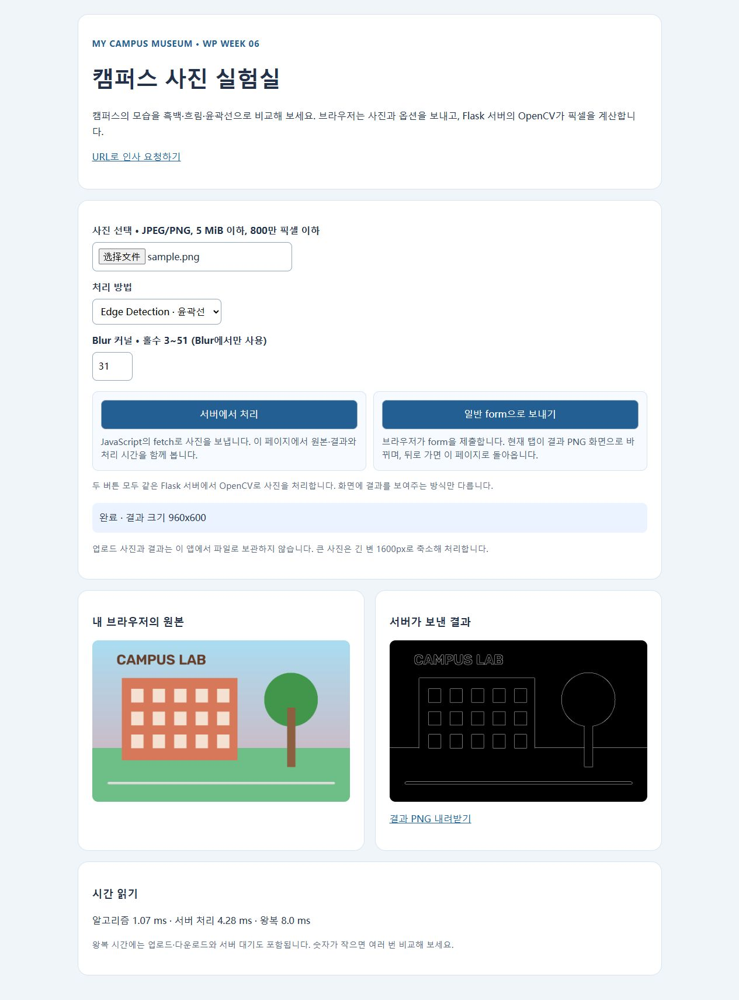
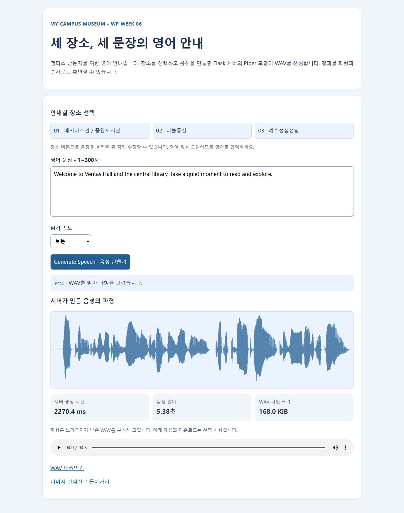
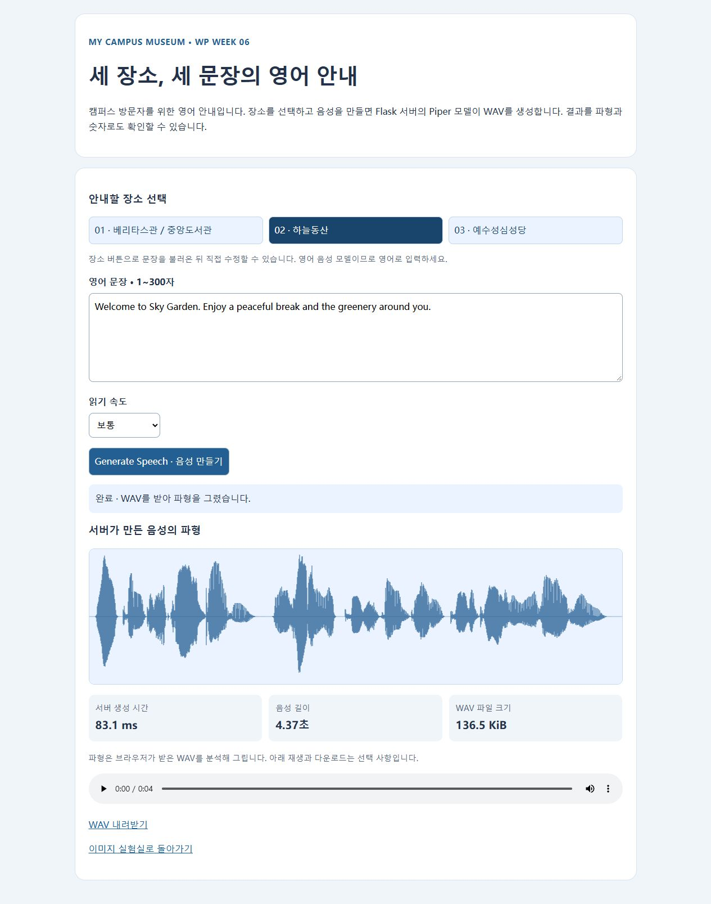

# 웹프로그래밍 Week 06 · 캠퍼스 서버 실험

교수님이 제공한 `week06-server-lab.zip`을 바탕으로 제작했습니다. 기존 캠퍼스 박물관의 장소를 영어로 안내하는 기능과 캠퍼스 사진 실험실을 추가했습니다.

## 진행 상태

- 로컬 이미지 처리와 영어 TTS 실행 및 브라우저 확인 완료.
- Render 이미지 서비스 배포 완료: https://anjunyuan-wp-week6.onrender.com/
- 외부 접속에서 `/health`의 `{"status":"ok"}`, 이미지 API의 `200 image/png`와 실제 결과 PNG를 확인했습니다. 휴대전화의 사진 업로드 검증은 별도로 진행 중입니다.

Render는 GitHub `main` 브랜치의 `week6` 폴더를 사용하며 Python 3.12.12, Free 인스턴스, Gunicorn으로 실행합니다. 서버의 시작 코드는 `app:app`이며 TTS는 안내대로 로컬에서 실행합니다. 처음 배포한 소스는 `4bd9427`입니다. 배포 후 사진 선택 안내 문구를 수정해 자동 재배포를 확인할 수 있도록 했습니다.

외부 HTTP 요청으로 교수님 샘플(960×600)을 Blur 31로 처리한 결과: 계산 **9.57 ms**, 서버 처리 **529.98 ms**, 결과 크기 **960×600**, 응답 크기 **178731 bytes**, `Cache-Control: no-store`. 로컬 표의 값과 서버 환경이 다르며, 이 외부 요청에서는 브라우저 왕복 시간을 측정하지 않았습니다.

## 직접 추가한 기능

- 베리타스관/중앙도서관, 하늘동산, 예수성심성당의 영어 안내 문장 선택 버튼 3개.
- 선택한 문장을 수정하고 읽기 속도를 조절한 뒤 서버에서 새 WAV를 생성할 수 있습니다.
- 선택 장소 표시와 요청 중 전체 입력 비활성화로 중복 요청을 방지합니다.
- `/hello`의 기본 이름을 `새 친구`로 바꾸고 캠퍼스 박물관 환영 문구를 추가했습니다. 이름은 Jinja의 기본 HTML 이스케이프를 유지합니다.

## Task 1 · 이미지 처리

`POST /api/process`에 `multipart/form-data`로 `image`, `operation`, `kernel`을 보냅니다. 성공 응답은 `200 image/png`이며, 응답 헤더 `X-Compute-Ms`, `X-Processing-Ms`, `X-Image-Size`를 읽습니다. 일반 form은 결과 PNG로 이동하고 fetch는 현재 페이지의 원본·결과·시간을 갱신합니다.

교수님 샘플 PNG를 사용한 로컬 브라우저 실측입니다. 큰 입력은 같은 샘플을 2400×1500으로 확대한 것이며 새로운 세부 정보가 생긴 것은 아닙니다. 왕복 시간은 브라우저의 `performance.now()`로, 나머지는 서버 응답 헤더로 기록했습니다.

| 입력 크기 | 처리 | 커널 | 실제 처리 크기 | 계산 ms | 서버 ms | 왕복 ms |
|---|---|---:|---|---:|---:|---:|
|960×600|Grayscale|15 (미사용)|960×600|0.25|16.15|24.1|
|960×600|Blur|3|960×600|0.76|6.12|10.0|
|960×600|Blur|31|960×600|4.90|11.59|19.0|
|960×600|Edge|31 (미사용)|960×600|1.07|4.28|8.0|
|2400×1500|Blur|31|1600×1000|11.63|40.91|49.3|

Blur 커널이 커질수록 계산량이 증가했습니다. 큰 사진은 긴 변 1600px로 축소한 뒤 처리하므로 원본 크기와 실제 처리 크기를 구분했습니다. 서버 처리 시간에는 디코딩·인코딩 등이 포함되고 왕복에는 전송과 대기도 포함됩니다. 위 수치는 단일 요청 결과로 기기 전체 성능을 대표하지 않습니다.





Flask 테스트 클라이언트에서 파일 누락/잘못된 옵션 `400`, 5 MiB 초과 `413`, 없는 경로 `404`, 정상 PNG 디코딩 및 크기 제한을 확인했습니다. 업로드와 결과는 메모리에서 처리하며 서버 파일로 저장하지 않습니다.

## Task 2 · 캠퍼스 영어 안내

용도는 캠퍼스 방문자에게 세 장소를 짧은 영어 문장으로 소개하는 것입니다. `POST /api/tts`에 JSON `{ "text": "...", "length_scale": 1.0 }`을 전송합니다. Flask의 Piper가 실제 음성을 만들고 `200 audio/wav`를 반환합니다. 브라우저가 WAV를 디코딩해 파형과 음성 길이, 크기를 표시합니다. 브라우저 자체 음성 합성이나 미리 녹음한 파일을 사용하지 않습니다.

모델은 영어용 `en_US-lessac-low`입니다. 모델과 설정 파일은 직접 내려받으며 Git에 포함하지 않습니다. 처음 요청은 모델 로딩을 포함하므로 이후 요청과 시간이 다릅니다.

| 브라우저에서 확인한 문장 | 서버 생성 ms | 음성 길이 s | WAV KiB |
|---|---:|---:|---:|
|Welcome to Veritas Hall and the central library. Take a quiet moment to read and explore.|2270.4|5.38|168.0|
|Welcome to Sky Garden. Enjoy a peaceful break and the greenery around you.|83.1|4.37|136.5|

각 문장의 음절과 쉬는 구간에 따라 파형과 길이가 달라졌습니다. 요청 중 Processing 표시와 버튼 비활성화, 생성 후 버튼 복구 및 다운로드 링크를 브라우저에서 확인했습니다. 빈 문장·300자 초과·지원하지 않는 언어 `400`, 모델 누락 `503`과 안내 메시지, 실제 WAV 헤더 및 길이는 테스트 클라이언트로 확인했습니다.




## AI 활용

ChatGPT/Codex를 활용해 교수님 시작 코드의 구조를 확인하고 캠퍼스 안내 버튼, 화면 문구, 실행 절차, 오류 검증과 보고서 문장을 정리했습니다. 제작 방향은 캠퍼스 영어 안내와 세 장소 소개로 정했습니다. 실제 Flask/OpenCV/Piper 실행 결과와 브라우저의 이미지·파형·시간을 확인한 내용만 실험 결과로 기록했습니다.

---

## 실행 안내

Python 3.12 환경을 사용합니다. 전체 수업 설명은 강의 사이트의 6주차 자료에 있습니다.

## 이미지 실험실

```sh
python -m pip install -r requirements.txt
python -m flask --app app run --debug --port 5000
```

브라우저에서 http://127.0.0.1:5000 을 엽니다. VS Code Live Server로 HTML을 열지 않습니다.
샘플 이미지는 `static/sample.png`입니다. 사진은 JPEG/PNG, 5 MiB 및 800만 픽셀 이하입니다.

## 서버 TTS

이미지 서버를 Ctrl+C로 종료한 뒤 실행합니다.

```sh
python -m pip install -r requirements-tts.txt
python -m piper.download_voices en_US-lessac-low --download-dir models
python -m flask --app tts_app run --debug --port 5000
```

http://127.0.0.1:5000/tts 를 엽니다. 기본 모델은 영어용입니다.
영어 문장을 보내면 서버가 WAV를 만들고 브라우저가 파형, 서버 생성 시간, 음성 길이와 파일 크기를 표시합니다.
실습실에 스피커가 없어도 파형으로 결과를 확인할 수 있습니다. 재생과 다운로드는 선택 기능입니다.
이 TTS 실습은 Windows PC의 로컬 서버에서 실행하며 별도 배포하지 않습니다.
모델은 직접 내려받으며 이 배포 파일에는 포함하지 않습니다.
엔진과 음성 모델의 이용 조건은 각 프로젝트에서 확인합니다.

- Piper: https://github.com/OHF-Voice/piper1-gpl
- 모델 카드: https://huggingface.co/rhasspy/piper-voices/blob/main/en/en_US/lessac/low/MODEL_CARD

## Render 이미지 앱 설정

학생 저장소의 `week6` 폴더에 이 파일들을 둡니다.
Root Directory: `week6`
Build Command: `pip install -r requirements.txt`
Start Command: `gunicorn app:app --bind 0.0.0.0:$PORT --workers 1 --threads 2 --timeout 120`
Python은 3.12 계열을 지정합니다. 수업 자료의 배포 절차를 확인하세요.

이 앱은 업로드 이미지와 생성한 결과를 영구 저장하지 않습니다.
프론트엔드는 같은 Flask 서버가 제공하므로 별도 CORS 설정은 사용하지 않습니다.
