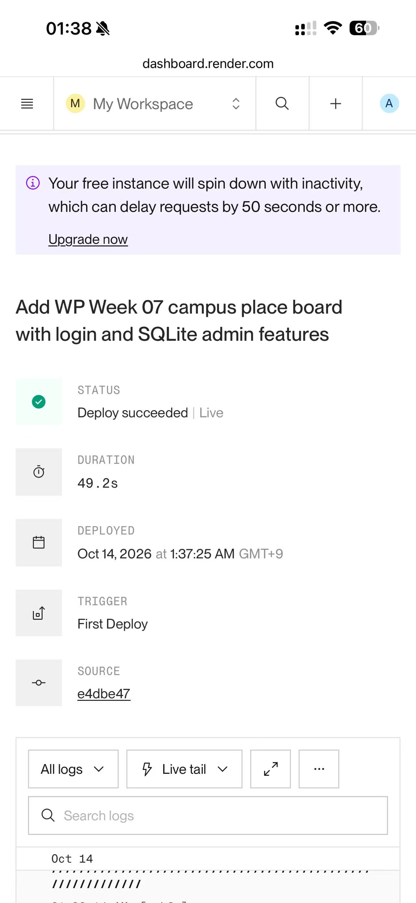
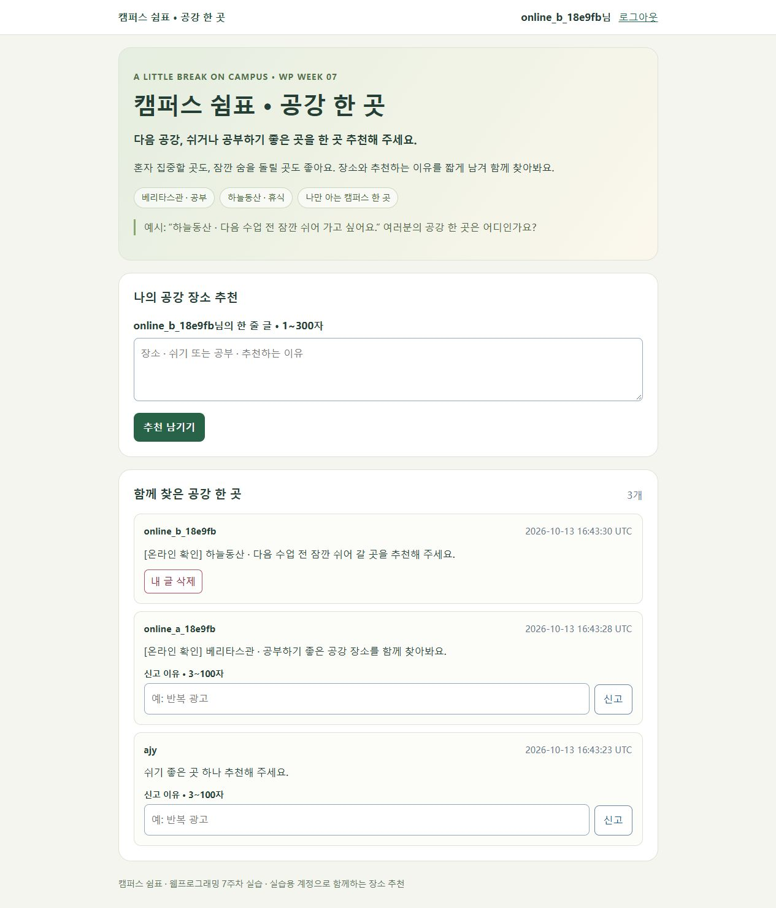
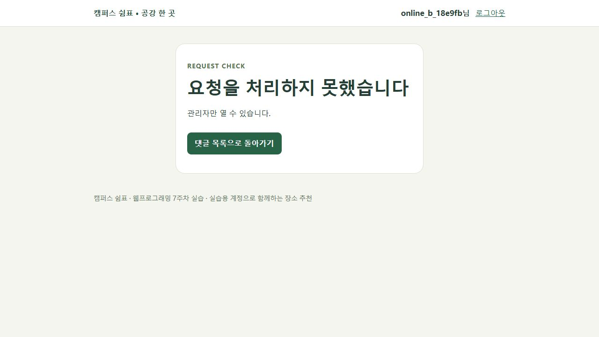

# 웹프로그래밍 Week 07 · 캠퍼스 쉼표

## 주제와 제작 내용

**공강에 쉬거나 공부하기 좋은 장소를 추천하는 한 줄 게시판**입니다. 제목은 `캠퍼스 쉼표 · 공강 한 곳`, 질문은 `다음 공강, 쉬거나 공부하기 좋은 곳을 한 곳 추천해 주세요.`로 정했습니다. 장소·휴식 또는 공부·추천 이유를 짧게 남기는 방식입니다. 베리타스관과 하늘동산을 예시로 제시하고 초록색과 크림색으로 화면을 구성했습니다.

교수님이 제공한 `week07-starter.zip` → `week07-feed.zip` → `week07-flask-comments.zip` 순서로 실행·확인했습니다. 최종 소스는 관리 기능 단계의 전체 코드를 바탕으로 하며, 각 단계에서 **같은 DB를 유지**해 계정과 글이 보존되는지 확인했습니다.

로컬 구현·검증과 화면 기록을 완료하고 Render에 배포했습니다. **공개 서비스 URL: https://anjunyuan-wp-week7.onrender.com/**. 사용자가 제공한 Render 화면에서 `Deploy succeeded | Live`와 배포 소스 `e4dbe47`을 확인했습니다. 외부 접속과 일반 계정 기능 검증도 완료했습니다. 휴대전화에서 작성한 글을 컴퓨터의 다른 계정에서도 확인했고, 사용자는 배포된 앱의 관리자 로그인과 관리 화면 진입이 정상임을 확인했습니다.

## 수정한 파일

| 파일 | 수정 내용 |
|---|---|
|`app.py`|게시판 제목과 질문을 공강 장소 추천 주제로 변경|
|`templates/comments.html`|초대 문구·장소 예시·입력 힌트·추천 버튼·목록 제목 변경|
|`templates/base.html`|주제에 맞는 하단 문구, 관리자 이름 대신 역할 표시|
|`templates/admin.html`|관리자 계정명을 화면 기록에 노출하지 않도록 역할로 표시|
|`static/style.css`|초록색·크림색 테마와 장소 태그|

비밀번호 해시, 매개변수 SQL, 서버 측 작성자·관리자 권한 확인, CSRF, 차단, 속도 제한과 DB 구조는 교수님 코드의 동작을 유지했습니다.

## 저장 방식 비교

`mini_storage.py`를 새 폴더에서 두 번 실행한 결과입니다.

| 실행 | Python 리스트 | JSON 파일 | SQLite 파일 |
|---|---:|---:|---:|
|첫 번째|1|1|1|
|두 번째|1|2|2|

리스트는 새 프로세스에서 초기화되지만 JSON과 SQLite는 이전 파일을 읽어 누적했습니다. 게시판은 사용자와 글의 관계를 조회해야 하므로 SQLite를 사용합니다. 이 실험의 파일과 게시판의 `app.db`는 서로 다릅니다.

## 로컬 실행 · Python 3.12

저장소의 `week7` 폴더에서 PowerShell로 실행합니다. 이미 사용하는 Python 3.12 환경이 있으면 가상환경 생성·활성화 단계는 생략합니다.

```powershell
python -m venv .venv
.\.venv\Scripts\Activate.ps1
python -m pip install -r requirements.txt
$env:SECRET_KEY = (& python -c "import secrets; print(secrets.token_hex(32))")
python -m flask --app app init-db
python -m flask --app app run --debug --port 5000
```

`http://127.0.0.1:5000/`을 엽니다. 실행 화면 기록에서는 이전 주차 서버와 충돌하지 않도록 **5001 포트**를 사용했습니다. debug는 로컬에서만 사용합니다. 서버를 다시 켤 때 같은 `SECRET_KEY`와 DB 경로를 사용합니다. `init-db`는 기존 데이터를 지우지 않습니다.

관리자용 실습 계정을 웹에서 먼저 가입한 뒤 서버를 멈추고, 같은 터미널에서 가입한 ID를 지정합니다. 실제 관리자 ID·PW는 공개 문서에 적지 않습니다.

```powershell
$env:WEEK7_ADMIN_USERNAME = Read-Host "가입한 실습용 관리자 ID"
python -m flask --app app promote-admin
python -m flask --app app run --debug --port 5000
```

## 두 계정·권한 확인

서로 독립된 Flask 테스트 클라이언트와 쿠키로 아래 요청을 검증했습니다. 실제 브라우저에서는 A로 로그인한 화면과 로그아웃 후 B로 바꾼 화면을 각각 기록했습니다. 두 캡처가 동시에 열린 서로 다른 브라우저라는 뜻은 아닙니다.

| 확인 | 실제 결과 |
|---|---|
|중복 아이디 / 잘못된 비밀번호|400 / 401로 거부|
|로그인 후 다음 요청 / 독립 클라이언트|로그인 유지 / 다른 클라이언트는 비로그인|
|시작 → 피드 → 관리 단계|새 프로세스에서도 기존 계정 3개와 추천 글 2개 유지|
|A 글을 B가 조회|같은 글이 보이며 A 글의 삭제 버튼 없음|
|B가 A 글 삭제 주소에 직접 POST|403으로 거부, 글 유지|
|본인 글 삭제|성공 후 목록으로 이동|
|`<script>alert(1)</script>` 글|이스케이프된 문자로 표시|
|CSRF 값 없이 POST|400으로 거부|
|빈 글 / 300자 초과|400으로 거부|
|일반 계정의 `/admin` 및 관리 POST|403으로 거부|
|1분 동안 글 3개 이후 추가 작성|429로 거부|
|세션 쿠키|HttpOnly와 SameSite=Lax 확인|


## 관리 기능 확인

- `promote-admin`으로 로컬 관리자 역할을 지정했습니다. `ensure-admin` 반복 실행은 성공하고, 같은 이름의 일반 계정을 관리자로 바꾸려는 경우에는 거부됐습니다.
- 연습 데이터 생성 시 임의 계정 **2개**, 글 **4개**가 생성됐습니다. B가 A의 글을 신고한 뒤 신고 전용 필터와 검색으로 이유를 확인했습니다.
- 중복 신고와 자기 글 신고는 400으로 거부됐습니다. 관리자 삭제 후 해당 글의 신고도 외래 키 규칙에 따라 사라졌습니다.
- 차단한 계정은 새 로그인에서 403을 받았고 기존 세션으로도 글을 쓸 수 없었습니다. 차단 해제 후 다시 로그인할 수 있었습니다.
- 연습 데이터 정리 후 연습 계정과 글이 0개가 됐으며 원래 계정과 추천 글은 유지됐습니다.

아래는 임시 비밀번호 표시가 없는 상태에서 기록했습니다. 표시된 신고는 관리 기능 확인용 연습 신고입니다.


## Render 온라인 실행 확인

배포된 주소에서 서로 다른 쿠키를 가진 두 실습 클라이언트로 실제 HTTP 요청을 보내 **24개 확인 항목**을 통과했습니다. 이는 로컬 테스트 결과와 구분한 온라인 실행 결과입니다.

| 확인 | 결과 |
|---|---|
|회원가입·로그인·다음 요청|정상 실행, 로그인 상태 유지|
|중복 가입 / 잘못된 비밀번호|400 / 401|
|A 글을 B가 조회하고 B 글을 A가 조회|같은 서버의 글 목록 공유|
|B가 A 글을 직접 삭제|403, A 글 유지|
|일반 계정의 관리 화면|403|
|CSRF 확인 값 없는 POST|400|
|자기 글 삭제 / 남의 글 신고|정상 실행|
|중복 신고 / 자기 글 신고|400|
|빈 글 / 300자 초과|400|
|`<script>`가 포함된 내용|문자로 이스케이프되어 표시|

컴퓨터 브라우저에서도 별도 실습 계정으로 로그인해 공유된 글 목록과 본인 글의 삭제 버튼을 확인했습니다. 온라인 확인용 글은 `[온라인 확인]`으로 표시했습니다. 관리 기능 확인용 연습 신고는 실제 부적절한 게시물 판정이 아닙니다.

휴대전화에서 작성한 `쉬기 좋은 곳 하나 추천해 주세요.`가 컴퓨터의 다른 계정에서도 표시됐습니다. 작성 계정이 다르므로 컴퓨터 계정에는 해당 글의 삭제 버튼이 없고 신고 form이 나타났습니다. 사용자는 휴대전화에서 관리자 계정으로 로그인하여 관리 화면에 정상적으로 들어갈 수 있음을 확인했습니다. 실제 관리자 ID·PW는 이 문서에 기록하지 않습니다.

사용자는 배포된 관리 화면에서 **연습 계정·글 생성, 신고 필터 또는 검색, 계정 차단·해제, 연습 데이터 정리**도 모두 정상 실행됨을 확인했습니다. 이 항목은 사용자가 직접 수행해 알려 준 온라인 검증이며, 위 로컬 자동 요청 검증과 구분합니다.





## Render 배포 설정

6주차 서비스는 유지하고 **새 Web Service**를 생성합니다.

| 항목 | 값 |
|---|---|
|저장소 / 분기|`a1141114a/anjunyuan` / `main`|
|Language|Python 3|
|Root Directory|`week7`|
|Build Command|`pip install -r requirements.txt`|
|Instance Type|Free · 생성 전 실제 요금 표시 확인|
|Health Check Path|`/` · 이 앱에는 `/health` 경로가 없음|

Start Command:

```sh
python -m flask --app app init-db && python -m flask --app app ensure-admin && gunicorn app:app --bind 0.0.0.0:$PORT --workers 1 --threads 2
```

Environment:

| 이름 | 설정 |
|---|---|
|`SECRET_KEY`|비공개 무작위 64자리 값|
|`WEEK7_ADMIN_USERNAME`|실습 전용 관리자 ID · 영문/숫자/밑줄 3~20자|
|`WEEK7_ADMIN_PASSWORD`|실습 전용 무작위 비밀번호 · 12~128자|
|`APP_HTTPS`|`1`|
|`PYTHON_VERSION`|`3.12.12`|

무료 Render의 SQLite 파일은 재시작·재배포 시 사라질 수 있습니다. 시작 명령은 DB와 관리자 계정을 다시 준비하므로 기능 시연은 가능하지만 장기 보관용은 아닙니다. `instance/`, `.env`, 비밀 키와 비밀번호는 Git에 포함하지 않습니다.

## 제출 항목

사이버캠퍼스에 **GitHub 저장소 URL, Render 서비스 URL, 관리자 ID, 관리자 PW**를 적습니다. 저장소는 https://github.com/a1141114a/anjunyuan 이고, 이번 주차 소스·보고서는 https://github.com/a1141114a/anjunyuan/tree/main/week7 에 있습니다. 서비스는 https://anjunyuan-wp-week7.onrender.com/ 입니다. ID·PW는 제출란에서만 공유하며 README나 공개 화면에는 적지 않습니다. `SECRET_KEY`와 DB 파일은 제출하지 않습니다. 휴대전화의 관리자 로그인·관리 기능과 컴퓨터의 별도 계정 접속을 확인했습니다.

## AI 활용

AI는 일부 코드 작성·수정과 보고서 문장 다듬기에 활용했다.

## 교수님 자료

- [웹프로그래밍 7주차](https://cg.catholic.ac.kr/~mgchoi/WP/weeks/week07/)
- [시작 코드 ZIP](https://cg.catholic.ac.kr/~mgchoi/WP/downloads/week07-starter.zip)
- [첫 실습 ZIP](https://cg.catholic.ac.kr/~mgchoi/WP/downloads/week07-feed.zip)
- [관리 기능 ZIP](https://cg.catholic.ac.kr/~mgchoi/WP/downloads/week07-flask-comments.zip)
